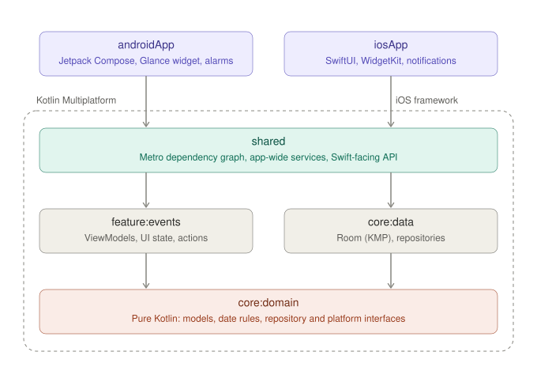

# Daysmark — Kotlin Multiplatform

<p>
  
  
  
  
</p>

A practical Kotlin Multiplatform app: a countdown and anniversary tracker for Android and iOS.
The rules, storage and screen state are written once in Kotlin; each platform keeps its own
native UI, SwiftUI on iOS and Jetpack Compose on Android. It is a complete app rather than a
sample: real persistence, notifications, Home Screen widgets, failure handling, localization and
tests on both platforms.

## What it does

- **Count down and count up**: days until the dates ahead, days since the ones that matter.
- **Repeating dates**: monthly or yearly events always show their next occurrence.
- **Home**: a focused event you can pin, category filters and the full list.
- **Edit, share and remind**: share an event as an image card; get reminders on the day or days before.
- **Home Screen widget**: WidgetKit on iOS, Glance on Android.
- **English and Simplified Chinese**, light and dark.

## Architecture



| Module | Responsibility |
|---|---|
| [`core:domain`](core/domain) | Pure Kotlin: models, day counting, ordering, repository and platform interfaces |
| [`core:data`](core/data) | Room (KMP) database and the repository implementations |
| [`feature:events`](feature/events) | ViewModels for Home, the editor, detail, sharing and onboarding: one `uiState` out, `onAction` in |
| [`shared`](shared) | The Metro dependency graph and app-wide services; builds the iOS framework |
| [`androidApp`](androidApp) | Jetpack Compose screens, Glance widget, alarm-based reminders |
| [`iosApp`](iosApp) | SwiftUI screens, WidgetKit extension, local notifications |

- **Clean layering, unidirectional data flow**: dependencies point inward, and the rules are
  enforced by Konsist tests rather than convention.
- **Compile-time DI** with [Metro](https://github.com/ZacSweers/metro).
- **Native UI on each platform**: shared ViewModels reach SwiftUI through
  KMP-ObservableViewModel and KMP-NativeCoroutines.
- How the code is written and why: [docs/spec](docs/spec/README.md).

## Requirements

- macOS with **Xcode 27** and [XcodeGen](https://github.com/yonaskolb/XcodeGen) 2.46.0
- **Android Studio** (its bundled JDK runs Gradle) and the Android SDK
- Runs on **Android 9** or later and **iOS 26** or later

## Run

Android, on a running emulator or connected device:

```bash
./gradlew :androidApp:installDebug
```

iOS: generate the Xcode project, open it, and run the `Daysmark` scheme:

```bash
cd iosApp && xcodegen && open DaysmarkKMP.xcodeproj
```

Everything CI checks (formatting, static analysis, architecture tests, Kotlin, Android and iOS
tests):

```bash
scripts/verify.sh
```

## License

Released under the [MIT License](LICENSE).
